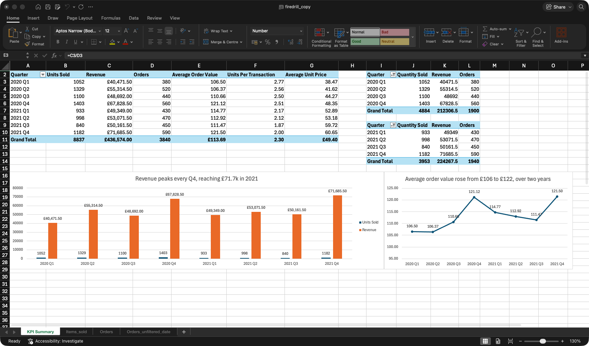
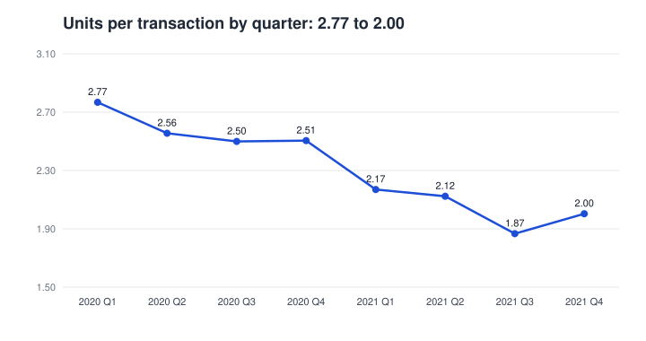
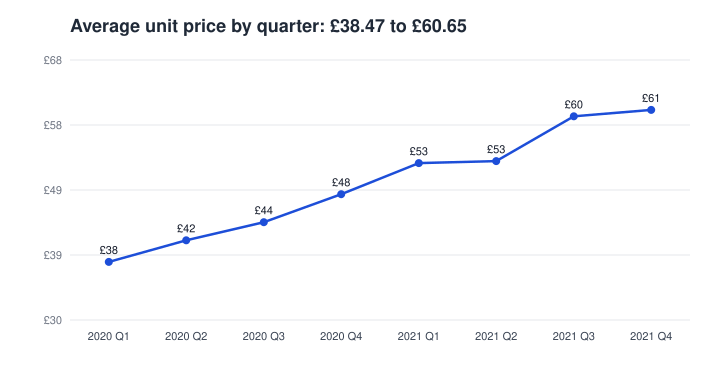
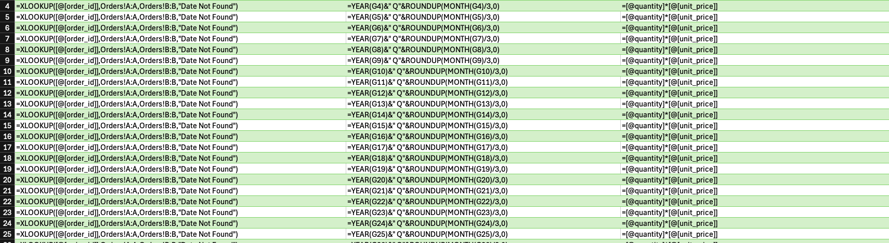

# Sales KPI analysis in Excel: AOV, UPT and AUP by quarter

**Revenue grew 5.6% in a year while units sold fell 19%. I cleaned two years of order data in Power Query and built the quarterly figures in Excel to show why: each item cost more, and customers bought fewer per order.**

| | |
|---|---|
| **Skills** | Power Query, Excel PivotTables, XLOOKUP, charts, data cleaning, checking results |
| **Data** | 3,999 order rows and 7,576 item rows from an online retailer, 2020 to 2021 |
| **Result** | Quarterly AOV, UPT and AUP, a year-on-year comparison and a recommended next step |
| **Context** | Solo exercise, iO-Sphere data analyst placement, November 2026 |

## Results

| Metric | 2020 | 2021 | Change |
|---|---|---|---|
| Revenue | £212,306.50 | £224,267.50 | **+5.6%** |
| Units sold | 4,884 | 3,953 | **-19.1%** |
| Orders | 1,900 | 1,940 | +2.1% |
| Average order value (AOV) | £111.74 | £115.60 | +3.5% |
| Units per transaction (UPT) | 2.57 | 2.04 | -20.7% |
| Average unit price (AUP) | £43.47 | £56.73 | **+30.5%** |

From the first quarter to the last (Q1 2020 to Q4 2021), AUP rose from £38.47 to £60.65 (+58%) and UPT fell from 2.77 to 2.00 (-28%). Revenue peaks every Q4, reaching £71.7k in 2021.

**Recommended next step:** split average unit price by product category, to test whether the rise comes from higher prices on the same products or from customers moving to pricier ones.

## How I did it

<b>Cleaning in Power Query</b>

Full M code in [`power-query/`](power-query/).

**Orders**
- Split `order_date` at the "T" to drop the time, then converted it to a date with the UK (en-GB) locale.
- Set `user_crm_id` to whole number and `delivery_fee` to currency.
- Trimmed, cleaned and capitalised `device_category` and `delivery_region`.
- Trimmed and cleaned `order_id`, which had stray spaces and hidden characters.
- Filtered to orders dated 2020 to 2021.

**Items_sold**
- Trimmed, cleaned and capitalised `product_name` and `category`.
- Trimmed and cleaned `order_id` so it matches Orders. Before this, XLOOKUP returned "Date Not Found" for some valid IDs.
- Removed "GBP" text from some `unit_price` values by splitting the column, then set it to currency.

**In Excel**
- Removed 137 duplicate order rows.
- Kept an unfiltered copy of Orders to check order IDs outside 2020 to 2021.

<b>Calculations</b>

- Each item row looks up its order date with XLOOKUP, then gets a quarter label and a line revenue (quantity x unit price).
- PivotTables sum units and revenue by quarter; COUNTIF counts orders per quarter.
- AOV = revenue / orders. UPT = units / orders. AUP = revenue / units.

All formulas: [`excel-formulas.md`](excel-formulas.md). Quarterly figures: [`data/kpi_by_quarter.csv`](data/kpi_by_quarter.csv).

<b>Checks and limits</b>

**Checks**
- Recalculated all 24 quarterly figures (8 quarters x 3 metrics) by hand against the pivots.
- Reconciled the order count: 3,999 raw rows, minus 137 duplicates = 3,862, minus 22 outside 2020 to 2021 = 3,840.
- Every one of the 3,840 orders matches its items, and every item row finds its order date.

**Limits**
- 76 orders have a blank `user_crm_id`. They still count, because the metrics do not use the customer ID.
- Dates that could be read two ways (03/04/2020) were assumed to be DD/MM/YYYY.
- Revenue comes from items sold, so delivery fees are not included.

## About the data

The retailer, Prism, and the director who asked the question are fictional; the order data is real retail data supplied for training. **The raw data is not in this repo**, only quarterly totals.
